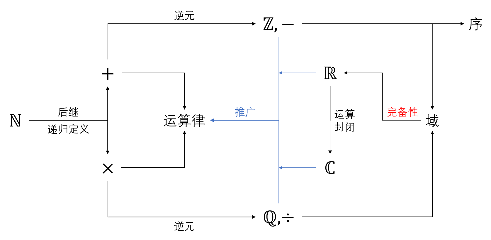

## 从自然数到有理数 {#number-systems-expansion}

数的扩张过程可以用下面这张图来表示。

{#fig-number-system}

首先，我们通过**数学归纳法原理**和**后继**的概念给出了**自然数**的定义，同时递归定义了**加法**和**乘法**。随后，我们利用**加法逆元**的概念定义了**减法**和**整数**，再利用**乘法逆元**的概念定义了**除法**和**有理数**。至此，我们已构建了一个**域**，即**有理数域**，它对四则运算封闭。

我们在有理数域中定义了**序**，并证明了它的**三歧性**（定理 1.3.5 和推论 1.3.7），从而给出**序域**的概念。我们在序域中可以定义**绝对值**，并给出**距离**的定义。至此，我们有了度量的手段，为微积分的基本概念——**极限**作铺垫。

## 完备性与实数 {#number-systems-completeness}

然而，在微积分研究中，仅有有理数域还远远不够。除了老师在课上举的例子以外，我更喜欢下面这种引入方式。在后续的课程中，我们会接触到**数列极限**的概念，并提出**Cauchy 收敛准则**。这可以算得上微积分中最基本的概念，即：

::: {.theorem}
数列 $\{x_n\}_{n\geq 1}\subseteq\RR$ 收敛当且仅当它是一个 **Cauchy 点列**，即对于任意 $\varepsilon>0$，存在 $N\in\mathbb{N}$，使得对任意 $m,n>N$，$|x_n-x_m|<\varepsilon$。
:::

Cauchy 收敛准则是判断数列收敛的好方法，因为它只需要研究数列本身的变化趋势，无需预先“开上帝视角”知道数列的极限值。然而，Cauchy 收敛准则成立的条件是**完备性**，即任何 Cauchy 点列都能收敛到原空间。这对空间以及空间的度量提出了要求，你能很轻松地在有理数域中构造出这样的数列来：

数列 $\{x_n\}_{n\geq 1}$，其中 $x_n$ 是 $\sqrt{2}$ 的 $n$ 位十进制近似。显然，$\{x_n\}_{n\geq 1}$ 是一个 Cauchy 点列，但它在有理数域中没有极限。[^sqrt-two]

所以仅仅有有理数域是不够的，我们必须要扩张数域。一种扩张的方法就是利用**确界**[^real-construction]，定义**实数**为有理数集合的上确界，并给出了 $\RR$ 中的**确界公理**（定理 1.4.14），进而说明它的完备性。这一章最重要的结论便是：**实数集 $\RR$ 是唯一一个具有确界性质的序域**。

[^sqrt-two]: 此处仅仅是给出一个例子说明有理数域不是完备的，读者不必纠结 $\sqrt{2}$ 的定义问题。
[^real-construction]: 也可以定义实数为 $\QQ$ 中 Cauchy 点列的极限，感兴趣的读者可自行查阅资料。
